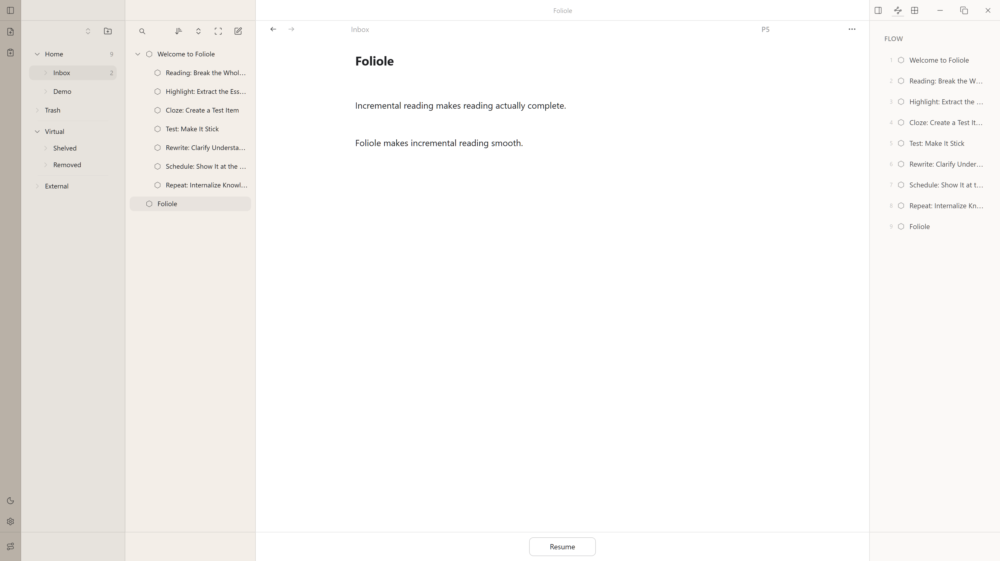

  
    <a href="https://github.com/campfirium/foliole/blob/dev/README.md">English</a> ·
    <a href="https://github.com/campfirium/foliole/blob/dev/docs/i18n/readme/README.de.md">Deutsch</a> ·
    <a href="https://github.com/campfirium/foliole/blob/dev/docs/i18n/readme/README.es.md">Español</a> ·
    <a href="https://github.com/campfirium/foliole/blob/dev/docs/i18n/readme/README.fr.md">Français</a> ·
    <a href="https://github.com/campfirium/foliole/blob/dev/docs/i18n/readme/README.hi.md">हिन्दी</a> ·
    <a href="https://github.com/campfirium/foliole/blob/dev/docs/i18n/readme/README.it.md">Italiano</a> ·
    <a href="https://github.com/campfirium/foliole/blob/dev/docs/i18n/readme/README.ja.md">日本語</a> ·
    <a href="https://github.com/campfirium/foliole/blob/dev/docs/i18n/readme/README.ko.md">한국어</a> ·
    <a href="https://github.com/campfirium/foliole/blob/dev/docs/i18n/readme/README.pl.md">Polski</a> ·
    <a href="https://github.com/campfirium/foliole/blob/dev/docs/i18n/readme/README.pt.md">Português</a> ·
    <a href="https://github.com/campfirium/foliole/blob/dev/docs/i18n/readme/README.ru.md">Русский</a> ·
    <a href="https://github.com/campfirium/foliole/blob/dev/docs/i18n/readme/README.zh.md">简体中文</a> ·
    <a href="https://github.com/campfirium/foliole/blob/dev/docs/i18n/readme/README.zh-Hant.md">繁體中文</a>
  

# Foliole

पढ़ना सचमुच पूरा करें। 
चरणबद्ध पठन के लिए एक सहज ऐप।

Foliole अभी बीटा में है और macOS, Windows, Linux (प्रायोगिक), iOS और Android पर उपलब्ध है। 
आप [ऑनलाइन डेमो](https://foliole.app/hi/demo/) में भी Foliole आज़मा सकते हैं।

  

## ऑनलाइन डेमो

[ऑनलाइन डेमो खोलें](https://foliole.app/hi/demo/)

यह इंटरैक्टिव डेमो आपके ब्राउज़र में स्थानीय रूप से चलता है। Foliole आज़माने के लिए कुछ भी इंस्टॉल करने की ज़रूरत नहीं है।

## डेमो वीडियो

[YouTube पर डेमो वीडियो देखें](https://youtu.be/Cp-EaCVS-Ds)

## डिज़ाइन के सिद्धांत

### ओपन सोर्स

कोड ओपन सोर्स है। कोई भी देख सकता है कि ऐप कैसे बनाया गया है, सोर्स कोड से ऐप बना सकता है या उसे बेहतर बनाने में योगदान दे सकता है।

  

### डेटा खुला है

Foliole SQLite डेटाबेस का इस्तेमाल करता है और डेटा की एक प्रति Markdown में भी उपलब्ध कराता है। इससे सामग्री पढ़ना, दूसरी जगह ले जाना और दोबारा इस्तेमाल करना आसान होता है।

  

### स्थानीय डेटा को प्राथमिकता

खाते बनाने की कोई व्यवस्था नहीं है और सिंक के लिए कोई केंद्रीय क्लाउड सेवा नहीं है। सारा डेटा आपके अपने डिवाइस पर रहता है। डिवाइस स्थानीय नेटवर्क के ज़रिए सिंक होते हैं।

  

## मुख्य सुविधाएँ

### चरणबद्ध पठन की अंतर्निहित सुविधा

Foliole को Piotr Woźniak के चरणबद्ध पठन के विचारों के आधार पर बनाया गया है। पढ़ते हुए ही आप अंश निकाल सकते हैं, पाठ के कुछ हिस्से छिपाकर रिक्त स्थान वाले सवाल बना सकते हैं और सामग्री को निखार सकते हैं।

  

### अंतर्निहित FSRS शेड्यूलिंग

Foliole में FSRS (Free Spaced Repetition Scheduler) शामिल है। यह दोहराई का समय तय करने वाला एक खुला और कुशल एल्गोरिदम है।

  

### पढ़ने की सामग्री एक जगह लाएँ

आप अलग-अलग स्रोतों की सामग्री एक जगह रख सकते हैं: स्थानीय फ़ाइलें, वेब दस्तावेज़, Obsidian में रखे नोट्स, Readwise Reader से निर्यात की गई सामग्री और दूसरे ऐप से चुना गया टेक्स्ट।

  

### बाहरी दस्तावेज़ों की इंडेक्सिंग

Foliole मूल फ़ाइलों को कॉपी या स्थानांतरित किए बिना आपके कंप्यूटर के दूसरे स्थानीय फ़ोल्डरों को इंडेक्स करता है। इससे बाहरी दस्तावेज़ों की एक लाइब्रेरी बनती है, जिसे आप समर्थित ऐप में खोज, देख और इस्तेमाल कर सकते हैं।

  

### जटिल सामग्री का समर्थन

Foliole Markdown, PDF और EPUB के साथ-साथ LaTeX के गणितीय सूत्र, कोड ब्लॉक और अन्य तरह की सामग्री भी दिखा सकता है।

  

### कमांड लाइन और एजेंट के साथ काम

टर्मिनल और स्थानीय एजेंट Foliole में सामग्री पढ़, लिख और व्यवस्थित कर सकते हैं। Foliole Aide की मदद से आप अपने ChatGPT प्लान में शामिल Codex उपयोग सीमा के भीतर सीधे ऐप में Codex इस्तेमाल कर सकते हैं।

  

### विकसित होते विषय प्रकाशित करें

Foliole में विकसित होते विषयों (Topics) को अपनी वेबसाइट, WordPress या Discourse पर प्रकाशित करें और वहाँ उन्हें आगे भी अपडेट करते रहें।

  

## सोर्स कोड से ऐप बनाएँ

macOS, Windows, Linux, Android और iOS के लिए [बिल्ड गाइड](../../BUILDING.md) देखें। रोज़मर्रा के इस्तेमाल के लिए [प्रकाशित रिलीज़ टैग](https://github.com/campfirium/foliole/releases) से शुरू करें। `dev` शाखा में अभी जारी न किए गए बदलाव होते हैं, जो सामान्य इस्तेमाल पर असर डाल सकते हैं।

## आभार

Piotr Woźniak और Jarrett Ye का विशेष धन्यवाद। SuperMemo, चरणबद्ध पठन और FSRS के बिना Foliole संभव नहीं होता।

इन ओपन सोर्स प्रोजेक्ट, घटकों और समुदायों का भी बहुत-बहुत धन्यवाद:

- [better-sqlite3](https://github.com/WiseLibs/better-sqlite3)
- [Capacitor](https://capacitorjs.com)
- [CodeMirror 6](https://codemirror.net)
- [Drizzle ORM](https://orm.drizzle.team)
- [Electron](https://www.electronjs.org)
- [Linux.do](https://linux.do)
- [React](https://react.dev)
- [SQLite](https://www.sqlite.org)
- [TypeScript](https://www.typescriptlang.org)
- [Vite](https://vite.dev)
